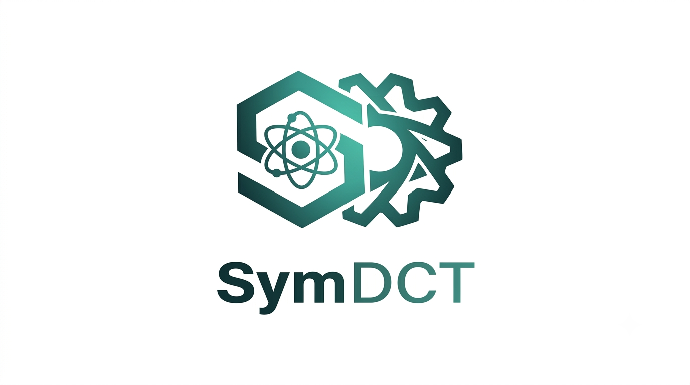

<p align="center">
  
</p>

<p align="center">
  A symbolic toolkit for analytical diffusion coefficient tensor calculations
  in crystals from atomic-scale kinetic data.
</p>

<p align="center">
  <a href="https://doi.org/10.5281/zenodo.24154111"></a>
</p>

---
# Current Status
> **Status:** Version 0.1.0, first public release of the code. Active development.

# What is SymDCT?
**SymDCT** (Symbolic Diffusion Coefficient Tensor) is

- **Graph-based**: represents diffusion networks by their connectivity, independent of a particular lattice realization
- **Symmetry-based**: exploits the space-group symmetry of the crystal to reduce the transport problem along each direction
- **Exact**: yields closed-form (analytical) diffusion coefficients
- **General**: applicable to complex, multi-site crystal structures beyond simple Bravais lattices
- **Interoperable**: accepts energetics and kinetics from first-principles (DFT) calculations or from ML interatomic potentials

# Main Features

## Theoretical foundation
- **Exact, closed-form solutions**: diffusion coefficients are derived analytically from the transition-rate matrix
- **Symmetry-adapted formulation**: sites related by space-group operations that keep the transport direction fixed are merged into classes, and a lumpability check confirms that the reduction is exact
- **Graph-based network representation**: diffusion pathways are encoded as connectivity graphs, which separates the topology of the jumps from the geometry of a particular lattice

## Computational machinery
The present version uses **SymPy** for all symbolic calculations.
The symbolic determinant becomes expensive for large reduced matrices, so
structures with many inequivalent sites can take a long time.
The bundled examples run in seconds.
For large matrices the script `scripts/solve_dc.wls` solves the same problem
with the Wolfram Language, see [docs/matrix_visualization.md](docs/matrix_visualization.md).

## Generality and scope
- **Applicable beyond simple Bravais lattices**: handles complex, multi-site crystal structures (e.g., tetragonal Be₁₂Ti with distinct interstitial site types)
- **Topological transferability**: results carry over across topologically equivalent diffusion networks, even when the underlying lattice differs
- **Separation of geometry and energetics**: the same symbolic machinery applies regardless of the energy source

## Interoperability
- **First-principles or ML-potential input**: migration barriers, binding energies, and attempt frequencies can come from DFT or from machine-learned interatomic potentials
- **Export of symbolic results**: transition-rate matrices and diffusion coefficients are written as text and in Mathematica format

# Scientific Background
Follows and significantly extends the framework developed by Ishioka and Koiwa in their 1985 paper [1].

# Installation

SymDCT needs Python 3.12 or newer and [uv](https://docs.astral.sh/uv/).

```bash
git clone https://github.com/vladimirovpv/SymDCT.git
cd SymDCT
uv sync
uv run pytest
```

# Quick Start

Run the full four-stage pipeline for one of the bundled examples:

```bash
uv run python main.py examples/hcp_vac/input/hcp_vac.yaml
```

The run writes its results into `examples/hcp_vac/output/`.
Reference results of the examples are stored in `examples/<name>/assets/`.

| Stage | Module | Role |
|---|---|---|
| 1 | `src.jump_network_builder` | Build the jump network from the structure and cutoffs |
| 2 | `src.matrix_builder` | Build and reduce the symbolic transition-rate matrix |
| 3 | `src.transport_coefficient_solver` | Solve for the symbolic diffusion coefficient |
| 4 | `src.transport_coefficient_evaluator` | Substitute energetics and plot Arrhenius curves |

# Examples

The folder `examples/` contains validation cases with known analytical
solutions (hcp vacancy, hcp and bcc interstitials) and a test of a defect
with several orientation states (diplon in fcc). See [examples/README.md](examples/README.md).

# Documentation

- [User guide](docs/user_guide.md): pipeline stages, input layout, output files
- [Viewing transition matrices and jump graphs](docs/matrix_visualization.md)
- [YAML and artifact contracts](docs/contracts.md)
- [Troubleshooting](docs/troubleshooting.md)
- Each stage has its own README in `src/<module>/README.md`

# Citation

If you use SymDCT in your research, please cite the software release:

> P. V. Vladimirov, *SymDCT: Symbolic diffusion-tensor computation from
> atomic-scale jump kinetics in anisotropic crystals*, version 0.1.0,
> Karlsruhe Institute of Technology (KIT), 2026.
> https://doi.org/10.5281/zenodo.24154112

The DOI above refers to version 0.1.0. The DOI [10.5281/zenodo.24154111](https://doi.org/10.5281/zenodo.24154111)
refers to all versions and resolves to the latest release.

The method implemented in SymDCT is described in the accompanying paper:

> P. V. Vladimirov, *SymDCT: Symbolic diffusion-tensor computation from
> atomic-scale jump kinetics in anisotropic crystals*, Computer Physics
> Communications, to be submitted.

# Author and License

**Author and maintainer:** Pavel V. Vladimirov, Karlsruhe Institute of Technology (KIT), Karlsruhe, Germany, ORCID [0000-0003-2358-6043](https://orcid.org/0000-0003-2358-6043)  
**Copyright:** Karlsruhe Institute of Technology (KIT)  
**License:** MIT, see [LICENSE](LICENSE)

The licenses of all required third-party Python packages are listed in
[THIRD_PARTY_LICENSES.md](THIRD_PARTY_LICENSES.md). None of them conflicts with the MIT license.
A machine-readable software bill of materials (SBOM) in CycloneDX 1.5 format is provided in [sbom.cdx.json](sbom.cdx.json).

# References

[1] S. Ishioka and M. Koiwa, "Diffusion coefficient in crystals with
  multiple jump frequencies," *Philosophical Magazine A* **52**,
  267–277 (1985). [DOI: 10.1080/01418618508237623](https://doi.org/10.1080/01418618508237623)

# Contact
Email: pavel.vladimirov@kit.edu  
Questions and bug reports: [GitHub issues](https://github.com/vladimirovpv/SymDCT/issues)
